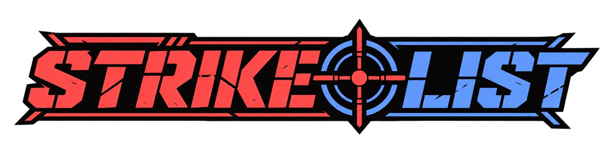
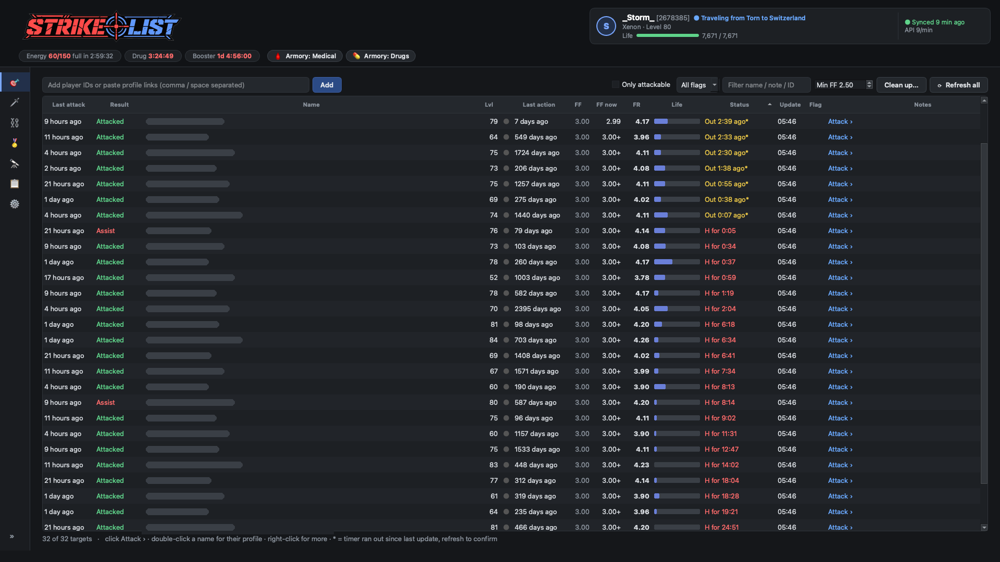

<b>A free desktop target tracker for <a href="https://www.torn.com">Torn</a> — Mac &amp; Windows.</b> 
Your API key and data stay on your computer. Built because YATA keeps going down.

## Features

| | |
|---|---|
| 🎯 **Targets** | Your hit list: last attack & result, FF, **FF now** (FF Scouter), **FR** (flat respect), level, last action, life, live hospital/travel countdowns, flags, notes, one-click attack. **Min FF + Clean up** removes targets you've outgrown. |
| 🗡️ **Attacks** | Your full attack log (pulled from the v2 API, all history), respect, FF, FR, chain number. Right-click any row to add that player to Targets. |
| ⛓️ **Chains** | Your hits per chain — length, your share, respect, avg FR/FF, best hit. Uses your faction's chain list when your key can see it. |
| 🏅 **Awards** | Every honor and medal with your progress, goal and estimated time to get it (YATA's awards engine). |
| 🔭 **War Scout** | Finds your ranked-war opponent (or any faction ID/link) and lists every member with **estimated stats**, "vs me", FF, estimated respect, your record on them and live status. Filter and build a list. |
| 📋 **War List** | Your pre-war hit list with live timers, 30-second auto-refresh (1 API call for the whole faction), flags, notes, and **Copy list** for Discord. |
| ⏱️ **Header** | Energy, drug & booster cooldowns, **live chain timer with alerts**, armory Medical/Drugs shortcuts, and your own status & life. |

## Download

Grab the latest **`.dmg`** (Mac, Apple Silicon) or **`.exe`** (Windows) from **[Releases](../../releases)**.

The apps aren't signed with paid certificates, so the first time you open them:
- **Mac:** right-click the app → **Open** → **Open**.
- **Windows:** SmartScreen → **More info** → **Run anyway**.

Then go to **Settings**, paste a **Limited Access** API key and click **Save**.

## How your API key is used

| Data storage | Data sharing | Purpose of use | Key storage & sharing | Key access level |
|---|---|---|---|---|
| Only on your computer | Nobody. If you turn on FF Scouter, your key and the player IDs you look up are sent to [ffscouter.com](https://ffscouter.com/) | Personal tools: targets, attack log, chains, awards, war lists | Saved only on your computer, readable by your user account only. Never shared, except with FF Scouter if you turn it on | Limited Access |

Strike List only **reads** from the Torn API. It never takes actions in the game for you.

Data folder: `~/Library/Application Support/StrikeList` (Mac) · `%APPDATA%\StrikeList` (Windows)

## Run from source

Needs Python 3.10+.

- **Mac:** double-click `Start Strike List.command`
- **Windows:** double-click `Start Strike List.bat`

The first start sets up a private Python environment (about a minute).

## Build the apps

- **Mac:** `bash build/build_mac.sh` → `build/release/StrikeList-<version>-mac.dmg`
- **Windows:** `build\build_windows.bat` → `build\release\StrikeList-<version>-windows.exe`

Each also writes the matching source zip.

## Credits & licence

- **Awards engine** from [YATA](https://github.com/Kivou-2000607/yata) by Kivou [2000607] (GPL-3) — thank you.
- **Stat estimates** by [FF Scouter](https://ffscouter.com/) (optional).
- Built with Qt for Python (PySide6), requests and NumPy — see [THIRD-PARTY-NOTICES.txt](THIRD-PARTY-NOTICES.txt).

Strike List is free software under the **GNU General Public License v3** — see [LICENSE.txt](LICENSE.txt).
Not affiliated with or endorsed by Torn.
